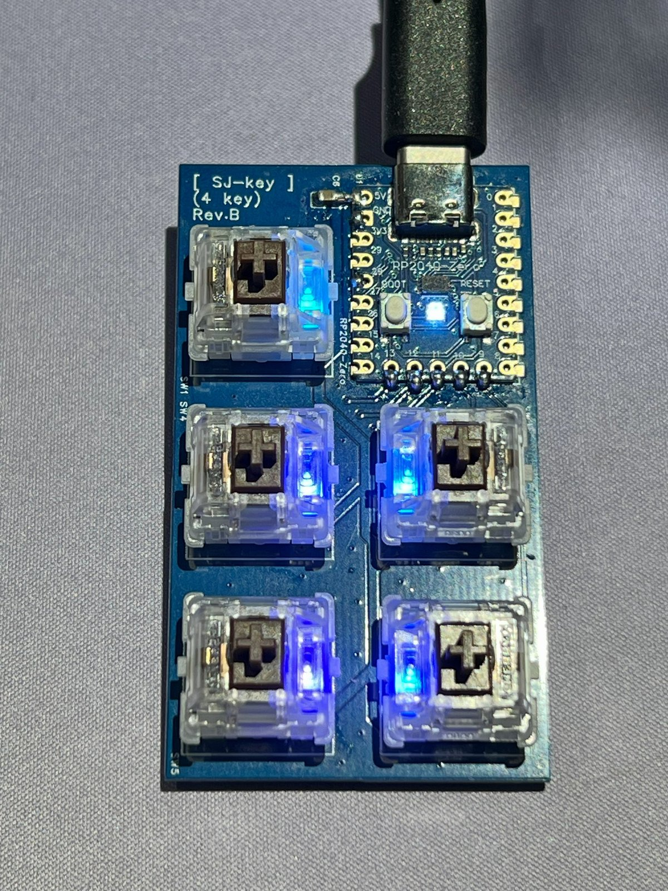
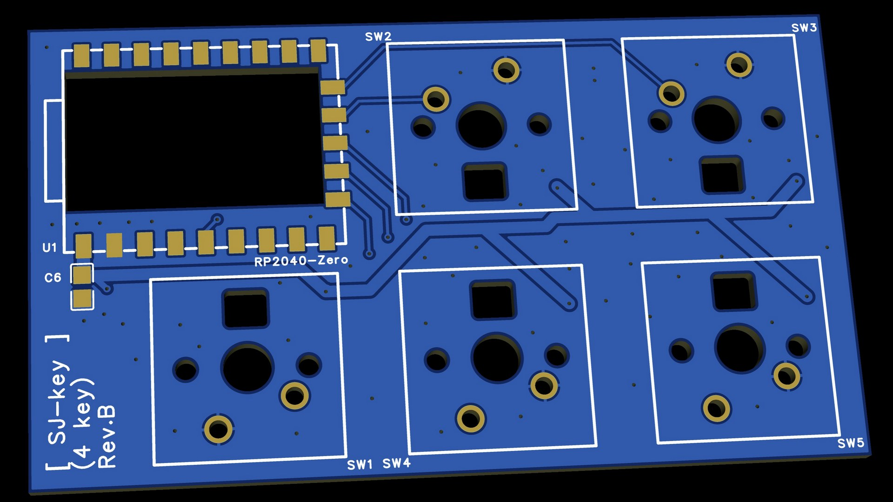
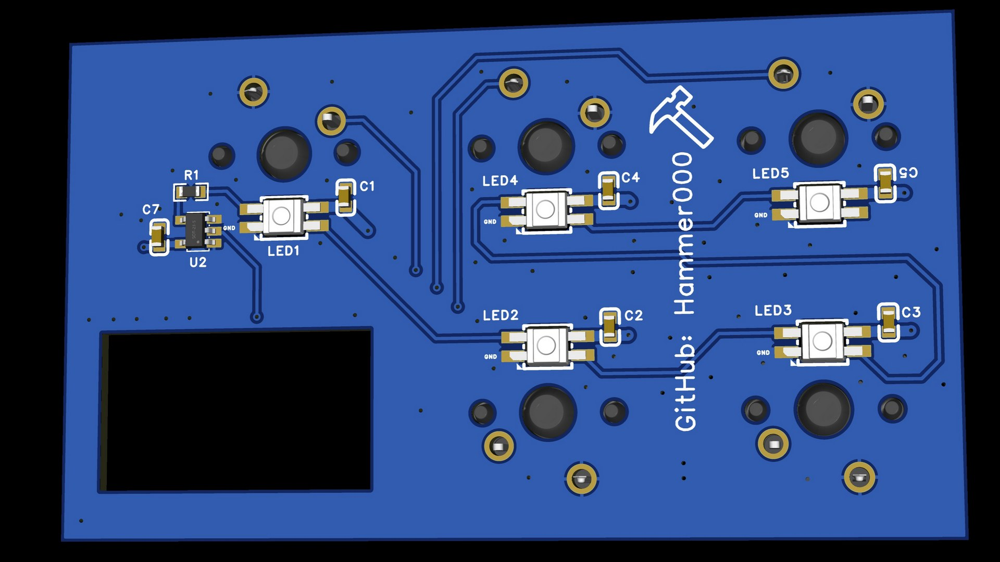

**English** | [繁體中文](README.zh-TW.md)

# SJ-key - USB MIDI Keyboard Controller

**SJ-key** is a mini USB MIDI keyboard controller based on the **RP2040-Zero** microcontroller, designed for DJ, VJ and live streaming use. Featuring 4 main keys and 1 function switch key, it supports 4 MIDI Banks, EEPROM persistence, and RGB key backlighting whose colors can be controlled from the computer.

  

---

## 📑 Table of Contents

- [Features](#-features)
- [Photos](#-photos)
- [Hardware and Pin Configuration](#️-hardware-and-pin-configuration-4-key-version)
- [PCB Manufacturing Files](#-pcb-manufacturing-files)
- [Bill of Materials (BOM)](#-bill-of-materials-bom)
- [Building and Flashing the Firmware](#-building-and-flashing-the-firmware)
- [Usage](#️-usage)
  - [Basic Operation](#basic-operation)
  - [MIDI Note Map](#midi-note-map)
  - [RGB LED Feedback (MIDI Input)](#rgb-led-feedback-midi-input)
  - [Using with OBS](#using-with-obs)
  - [Using with DJ Software](#using-with-dj-software)
  - [Using with VJ Software](#using-with-vj-software)
- [License](#-license)
- [Trademarks](#️-trademarks)

---

## ✨ Features

* **4 MIDI Bank Switching**: Cycle through banks using the `SW_MODE` key to control a total of 16 MIDI notes (4 key ver.).
* **EEPROM Persistence**: Automatically saves and restores the current Bank state after powering off.
* **RGB Lighting**: Per-key backlighting and an onboard status LED, with dynamic key color updates via MIDI Input.
* **Driverless**: A standard USB MIDI device (USB Class Compliant) that works out of the box on Windows / macOS / Linux. The device name is `SJ-key (4key)`.

---

## 📷 Photos

| PCB Top | PCB Bottom |
|:---:|:---:|
|  |  |

---

## 🛠️ Hardware and Pin Configuration (4-key version)

### 1. Button to GPIO Mapping

| PCB Silkscreen | Firmware Name | GPIO | Function |
|---|---|---|---|
| SW1 | SW_MODE | `GPIO 13` | MIDI Bank switching |
| SW2 | SW1 | `GPIO 10` | MIDI key 1 |
| SW3 | SW2 | `GPIO 9` | MIDI key 2 |
| SW4 | SW3 | `GPIO 11` | MIDI key 3 |
| SW5 | SW4 | `GPIO 12` | MIDI key 4 |

> 💡 The PCB silkscreen numbering differs from the firmware. `SW_MODE` and `SW1` ~ `SW4` in the rest of this document refer to the firmware names.

### 2. RGB LED Pins

* **Onboard RGB LED (WS2812B)**: `GPIO 16`
* **Key Backlight (SK6812 MINI-E)**: `GPIO 28`

---

## 📦 PCB Manufacturing Files

* **PCB revision**: Rev.B
* **Schematic**: [`20261031_SCH_Main_PCB_4key.pdf`](hardware/SJ-key_4key/schematic/20261031_SCH_Main_PCB_4key.pdf)
* **Gerber**: [`20261031_SJ-key_4key_Gerber.zip`](hardware/SJ-key_4key/gerber/20261031_SJ-key_4key_Gerber.zip)

The Gerber zip file can be uploaded directly to [JLCPCB](https://jlcpcb.com/) for ordering. Recommended order parameters:

| JLCPCB Parameter | Recommended Setting |
|---|---|
| Base Material | FR-4 |
| Layers | 2 |
| Dimensions | 70 mm × 40 mm |
| PCB Thickness | 1.6 mm |
| Surface Finish | ENIG |
| Outer Copper Weight | 1 oz |
| Via Covering | Tented |

---

## 🧾 Bill of Materials (BOM)

| Designator | Part | Qty |
|---|---|:---:|
| U1 | RP2040-Zero | 1 |
| U2 | SN74AHCT1G125DBVR (SOT-23-5) | 1 |
| SW1 ~ SW5 | CHERRY MX2A RGB (5 pin) | 5 |
| LED1 ~ LED5 | SK6812 MINI-E | 5 |
| C1 ~ C5, C7 | 0.1uF (0603) | 6 |
| C6 | 10uF 25V (0805) | 1 |
| R1 | 100Ω (0603) | 1 |

> 💡 U1, C6 and the switches are soldered on the top side of the PCB; all other SMD parts are on the bottom side. The SK6812 MINI-E is a reverse-mount LED: it is soldered on the bottom and lights the key through a hole in the PCB.

> 💡 Choose any switch type you like. Common models include `MX2A-L1NB` (Red), `MX2A-G1NB` (Brown) and `MX2A-E1NB` (Blue). This PCB has no plate, so the 5-pin versions (part numbers ending in `B`) are recommended for a more stable fit.

---

## 💻 Building and Flashing the Firmware

1. **Board Settings**: In the Arduino IDE, select **Raspberry Pi Pico** as your board, and set the USB Stack to **Adafruit TinyUSB** (`Tools > USB Stack > Adafruit TinyUSB`).
2. **Dependencies**: Install the `Adafruit TinyUSB Library`, `Control Surface` (by tttapa), and `FastLED` libraries.
3. **Flashing**: Connect your device via USB and upload the sketch in [`rp2040_arduino_sketch/SJ-key_4key`](rp2040_arduino_sketch/SJ-key_4key).

---

## 🎛️ Usage

### Basic Operation

* **SW1 ~ SW4**: Send MIDI Note On when pressed and Note Off when released (Channel 1).
* **SW_MODE**: Each press switches to the next Bank (1 → 2 → 3 → 4 → 1). The onboard LED color shows the current Bank.
* The Bank is saved automatically about 5 seconds after switching, and restored on the next power-up.

### MIDI Note Map

All keys use **MIDI Channel 1**. Each Bank shifts the notes up by one octave (+12).

| Bank | Onboard LED | SW1 | SW2 | SW3 | SW4 |
|:---:|:---:|:---:|:---:|:---:|:---:|
| 1 | ⚪ White | 24 | 26 | 28 | 29 |
| 2 | 🟢 Green | 36 | 38 | 40 | 41 |
| 3 | 🔵 Blue | 48 | 50 | 52 | 53 |
| 4 | 🟣 Purple | 60 | 62 | 64 | 65 |

> 💡 Note names may be displayed differently depending on the software. For example, note 24 is shown as `C0` in Ableton Live but may be shown as `C1` elsewhere. Always go by the note number.

### RGB LED Feedback (MIDI Input)

* By default the key backlight shows a rainbow gradient. When pressed, SW1 ~ SW4 light up red, green, blue and purple respectively.
* The computer can send a **Note On** to SJ-key to change a key's color:
  * **Note number**: The same note as that key in the current Bank (see the table above).
  * **Velocity (0~127)**: Selects a color from the built-in 128-color palette. `0` turns it off (back to the default lighting).
* Software that supports MIDI feedback (MIDI output) can use this to show status on the keys, for example whether a clip is playing or a scene is active.

### Using with OBS

OBS does not support MIDI natively, so you need a plugin such as [obs-midi-mg](https://github.com/nhielost/obs-midi-mg) or [Advanced Scene Switcher](https://github.com/WarmUpTill/SceneSwitcher).

1. Install the plugin and restart OBS.
2. Select `SJ-key (4key)` as the input device in the plugin settings.
3. Add a binding: press a key on SJ-key so the plugin detects the note, then assign an action, for example:
   * Switch scenes
   * Mute / unmute the microphone or other audio sources
   * Show / hide sources (e.g. captions, logos)
   * Start / stop recording or streaming
4. Make use of the 4 Banks, e.g. Bank 1 for scene switching, Bank 2 for audio control, and Bank 3 for effect sources.

### Using with DJ Software

Most DJ software has a **MIDI Learn / MIDI Mapping** feature, and the workflow is similar: enter MIDI mapping mode → click a function in the software → press a key on SJ-key to bind it.

| Software | How to Map MIDI |
|---|---|
| rekordbox | `MIDI` settings (MIDI Learn) |
| Serato DJ | Click the `MIDI` button at the top right to enter mapping mode |
| Traktor Pro | Add a Generic MIDI device in `Preferences > Controller Manager`, then use Learn |
| Mixxx | Use the Learning Wizard in `Preferences > Controllers` |
| VirtualDJ | `Settings > Controllers` |

Common uses: Hot Cues, loop on/off, effect on/off, sampler triggers.

### Using with VJ Software

| Software | How to Map MIDI |
|---|---|
| Resolume Arena / Avenue | `Shortcuts > Edit MIDI` (`Ctrl/Cmd + M`), click a clip or parameter, then press a key |
| TouchDesigner | Use the `MIDI In CHOP` or `MIDI Device Mapper` |
| MadMapper / VDMX / Synesthesia | All support MIDI Learn |

Common uses: triggering clips, switching layers / decks, toggling effects, tap tempo. If the software supports MIDI output feedback, combine it with [RGB LED Feedback](#rgb-led-feedback-midi-input) to show clip status on the keys.

---

## 📄 License

This project is licensed under the [MIT License](LICENSE).

## ™️ Trademarks

rekordbox, Serato DJ, Traktor, Mixxx, VirtualDJ, Ableton Live, Resolume, TouchDesigner, MadMapper, VDMX, Synesthesia, OBS Studio, JLCPCB, CHERRY and other names mentioned in this document are trademarks or registered trademarks of their respective owners. This project is not affiliated with, partnered with, or endorsed by any of these companies or projects. These names are mentioned only to describe compatibility and usage.
