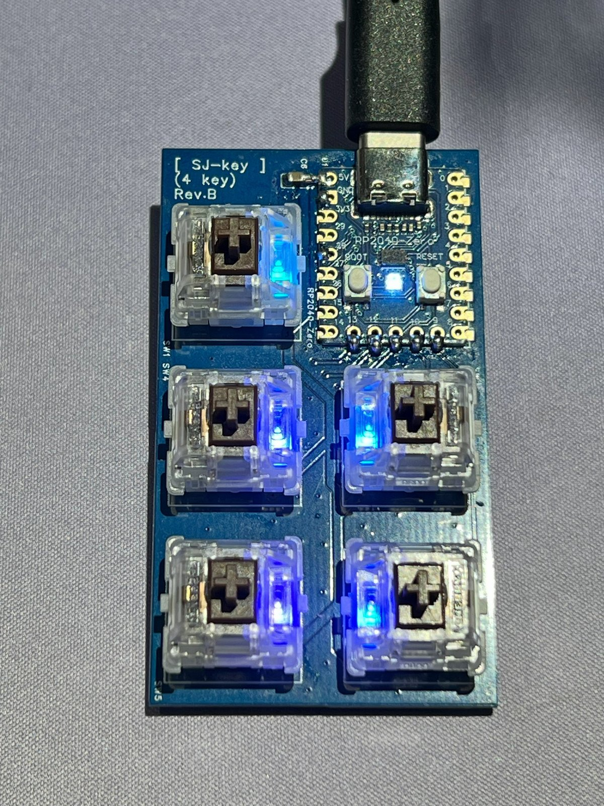
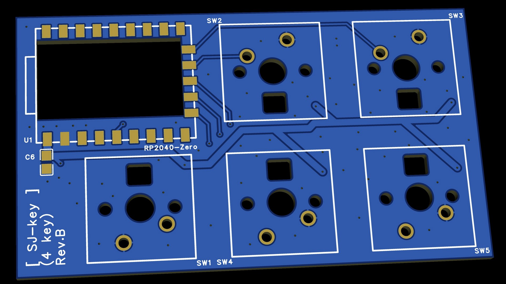
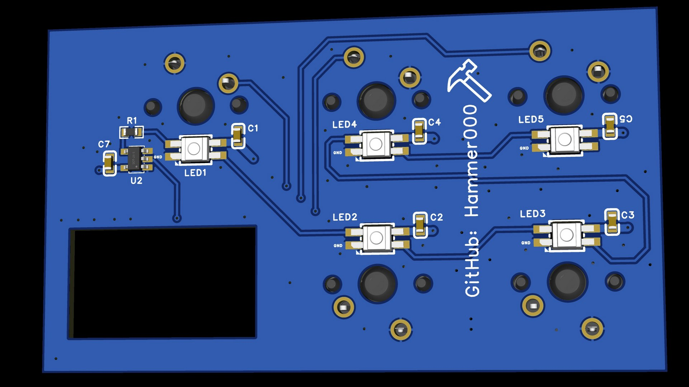

[English](README.md) | **繁體中文**

# SJ-key - USB MIDI 迷你控制器

**SJ-key** 是一款以 **RP2040-Zero** 為核心的迷你 USB MIDI 控制器，專為 DJ / VJ / 直播使用設計。具備 4 個主按鍵與 1 個功能切換鍵，支援 4 組 MIDI Bank、斷電記憶，以及可由電腦端控制顏色的 RGB 按鍵背光。

  

---

## 📑 目錄

- [功能特色](#-功能特色)
- [照片](#-照片)
- [硬體規格與腳位配置](#️-硬體規格與腳位配置4-key-版本)
- [PCB 製作檔案](#-pcb-製作檔案)
- [零件清單（BOM）](#-零件清單bom)
- [韌體編譯與燒錄](#-韌體編譯與燒錄)
- [使用說明](#️-使用說明)
  - [基本操作](#基本操作)
  - [MIDI 音符對照表](#midi-音符對照表)
  - [RGB 燈光回饋（MIDI Input）](#rgb-燈光回饋midi-input)
  - [搭配 OBS 使用](#搭配-obs-使用)
  - [搭配 DJ 軟體使用](#搭配-dj-軟體使用)
  - [搭配 VJ 軟體使用](#搭配-vj-軟體使用)
- [授權](#-授權)
- [商標聲明](#️-商標聲明)

---

## ✨ 功能特色

* **4 組 MIDI Bank 切換**：按 `SW_MODE` 鍵循環切換 Bank，4 個按鍵共可送出 16 個不同的 MIDI 音符（4 key 版本）。
* **斷電記憶**：自動儲存目前的 Bank，重新上電後回到上次使用的 Bank。
* **RGB 燈光**：按鍵背光與板載狀態燈，並可由電腦端透過 MIDI Input 動態改變按鍵顏色。
* **免驅動**：標準 USB MIDI 裝置（USB Class Compliant），Windows / macOS / Linux 插上即可使用，裝置名稱為 `SJ-key (4key)`。

---

## 📷 照片

| PCB 正面 | PCB 背面 |
|:---:|:---:|
|  |  |

---

## 🛠️ 硬體規格與腳位配置（4 key 版本）

### 1. 按鍵 GPIO 對應

| PCB 絲印 | 韌體名稱 | GPIO | 功能 |
|---|---|---|---|
| SW1 | SW_MODE | `GPIO 13` | 切換 MIDI Bank |
| SW2 | SW1 | `GPIO 10` | MIDI 按鍵 1 |
| SW3 | SW2 | `GPIO 9` | MIDI 按鍵 2 |
| SW4 | SW3 | `GPIO 11` | MIDI 按鍵 3 |
| SW5 | SW4 | `GPIO 12` | MIDI 按鍵 4 |

> 💡 PCB 絲印的編號與韌體不同，本文件其他章節提到的 `SW_MODE`、`SW1` ~ `SW4` 皆指韌體名稱。

### 2. RGB LED 腳位

* **板載 RGB LED（WS2812B）**：`GPIO 16`
* **按鍵背光（SK6812 MINI-E）**：`GPIO 28`

---

## 📦 PCB 製作檔案

* **PCB 版本**：Rev.B
* **電路圖**：[`20261031_SCH_Main_PCB_4key.pdf`](hardware/SJ-key_4key/schematic/20261031_SCH_Main_PCB_4key.pdf)
* **Gerber**：[`20261031_SJ-key_4key_Gerber.zip`](hardware/SJ-key_4key/gerber/20261031_SJ-key_4key_Gerber.zip)

Gerber zip 檔可直接上傳至 [JLCPCB](https://jlcpcb.com/) 下單，以下為建議的下單參數：

| JLCPCB 參數 | 建議設定 |
|---|---|
| Base Material | FR-4 |
| Layers | 2 |
| Dimensions | 70 mm × 40 mm |
| PCB Thickness | 1.6 mm |
| Surface Finish | ENIG |
| Outer Copper Weight | 1 oz |
| Via Covering | Tented |

---

## 🧾 零件清單（BOM）

| 位置編號 | 零件 | 數量 |
|---|---|:---:|
| U1 | RP2040-Zero | 1 |
| U2 | SN74AHCT1G125DBVR (SOT-23-5) | 1 |
| SW1 ~ SW5 | CHERRY MX2A RGB (5 pin) | 5 |
| LED1 ~ LED5 | SK6812 MINI-E | 5 |
| C1 ~ C5, C7 | 0.1uF (0603) | 6 |
| C6 | 10uF 25V (0805) | 1 |
| R1 | 100Ω (0603) | 1 |

> 💡 U1、C6 與按鍵焊接在 PCB 正面，其餘 SMD 零件皆在 PCB 背面。SK6812 MINI-E 為反貼式 LED，從背面焊接後透過 PCB 開孔照亮按鍵。

> 💡 軸色可依喜好選擇，常見型號如 `MX2A-L1NB`（紅軸）、`MX2A-G1NB`（茶軸）、`MX2A-E1NB`（青軸）。本 PCB 沒有定位板，建議選擇型號結尾為 `B` 的 5 pin 版本，按鍵固定較穩。

---

## 💻 韌體編譯與燒錄

1. **開發板設定**：在 Arduino IDE 中選擇 **Raspberry Pi Pico** 作為開發板，並將 USB Stack 設為 **Adafruit TinyUSB**（`Tools > USB Stack > Adafruit TinyUSB`）。
2. **相依函式庫**：安裝 `Adafruit TinyUSB Library`、`Control Surface`（by tttapa）與 `FastLED`。
3. **燒錄**：以 USB 連接裝置，上傳 [`rp2040_arduino_sketch/SJ-key_4key`](rp2040_arduino_sketch/SJ-key_4key) 中的 sketch 即可。

---

## 🎛️ 使用說明

### 基本操作

* **SW1 ~ SW4**：按下送出 MIDI Note On，放開送出 Note Off（Channel 1）。
* **SW_MODE**：每按一次切換到下一個 Bank（1 → 2 → 3 → 4 → 1），板載 LED 顏色代表目前的 Bank。
* 切換 Bank 後約 5 秒會自動儲存，下次上電會回到該 Bank。

### MIDI 音符對照表

所有按鍵皆使用 **MIDI Channel 1**，每切換一個 Bank 音高升高一個八度（+12）。

| Bank | 板載 LED | SW1 | SW2 | SW3 | SW4 |
|:---:|:---:|:---:|:---:|:---:|:---:|
| 1 | ⚪ 白 | 24 | 26 | 28 | 29 |
| 2 | 🟢 綠 | 36 | 38 | 40 | 41 |
| 3 | 🔵 藍 | 48 | 50 | 52 | 53 |
| 4 | 🟣 紫 | 60 | 62 | 64 | 65 |

> 💡 音符名稱在不同軟體顯示可能不同，例如 Note 24 在 Ableton Live 顯示為 `C0`，在其他軟體可能顯示為 `C1`。以音符編號為準即可。

### RGB 燈光回饋（MIDI Input）

* 平時按鍵背光為彩虹漸層；按下時 SW1 ~ SW4 分別亮紅、綠、藍、紫色。
* 電腦端可以傳送 **Note On** 到 SJ-key 改變按鍵顏色：
  * **音符編號**：與目前 Bank 中該按鍵的音符相同（見上表）。
  * **Velocity（0~127）**：對應內建 128 色色盤，`0` 為關閉（回到預設燈光）。
* 支援 MIDI 回饋（MIDI Feedback / Output）的軟體，可以用這個功能讓按鍵顏色顯示目前狀態（例如 Clip 是否播放中、場景是否啟用）。

### 搭配 OBS 使用

OBS 本身不支援 MIDI，需要安裝外掛，例如 [obs-midi-mg](https://github.com/nhielost/obs-midi-mg) 或 [Advanced Scene Switcher](https://github.com/WarmUpTill/SceneSwitcher)。

1. 安裝外掛後重新啟動 OBS。
2. 在外掛設定中選擇輸入裝置 `SJ-key (4key)`。
3. 新增綁定：按下 SJ-key 的按鍵讓外掛偵測到音符，再指定要執行的動作，例如：
   * 切換場景
   * 開關麥克風 / 音訊來源靜音
   * 顯示 / 隱藏來源（例如字幕、Logo）
   * 開始 / 停止錄影或直播
4. 善用 4 個 Bank，例如 Bank 1 切換場景、Bank 2 控制音訊、Bank 3 控制特效來源。

### 搭配 DJ 軟體使用

大多數 DJ 軟體都有 **MIDI Learn / MIDI Mapping** 功能，流程大致相同：開啟 MIDI 對應模式 → 點選軟體上的功能 → 按下 SJ-key 的按鍵完成綁定。

| 軟體 | MIDI 對應方式 |
|---|---|
| rekordbox | `MIDI` 設定（MIDI Learn） |
| Serato DJ | 右上角 `MIDI` 按鈕進入對應模式 |
| Traktor Pro | `Preferences > Controller Manager` 新增 Generic MIDI 後使用 Learn |
| Mixxx | `Preferences > Controllers` 使用 Learning Wizard |
| VirtualDJ | `Settings > Controllers` |

常見用途：Hot Cue、Loop 開關、效果器開關、Sampler 觸發。

### 搭配 VJ 軟體使用

| 軟體 | MIDI 對應方式 |
|---|---|
| Resolume Arena / Avenue | `Shortcuts > Edit MIDI`（快捷鍵 `Ctrl/Cmd + M`），點選 Clip 或參數後按下按鍵 |
| TouchDesigner | 使用 `MIDI In CHOP` 或 `MIDI Device Mapper` |
| MadMapper / VDMX / Synesthesia | 皆支援 MIDI Learn |

常見用途：觸發 Clip、切換 Layer / Deck、開關效果、Tap Tempo。若軟體支援 MIDI 輸出回饋，可搭配上方的 [RGB 燈光回饋](#rgb-燈光回饋midi-input) 讓按鍵顯示 Clip 狀態。

---

## 📄 授權

本專案採用 [MIT License](LICENSE)。

## ™️ 商標聲明

本文件中提及的 rekordbox、Serato DJ、Traktor、Mixxx、VirtualDJ、Ableton Live、Resolume、TouchDesigner、MadMapper、VDMX、Synesthesia、OBS Studio、JLCPCB、CHERRY 等名稱，均為其各自所有者的商標或註冊商標。本專案與上述公司或專案無任何隸屬、合作或背書關係，提及這些名稱僅用於說明相容性與使用方式。
